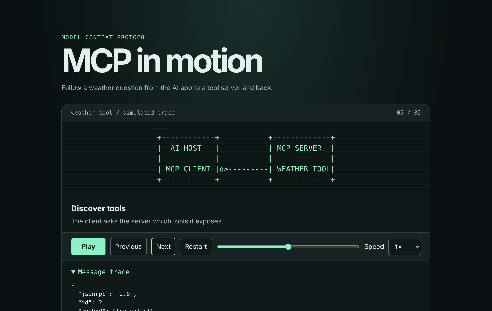

# MCP in Motion

### ▶ [Open the animation](https://jcliff01.github.io/mcp-dev/)

An animation that shows how an AI app talks to a tool server using the Model Context Protocol (MCP): how they connect, agree on what each side can do, and how the app calls a tool and gets the answer back. It's a learning aid; no MCP server, account or install is needed.

## Open it on your own computer

It is a single web page, so it works on Windows, macOS and Linux in any modern browser (Chrome, Edge, Firefox or Safari), even offline.

1. Click the green **Code** button on this page and choose **Download ZIP**.
2. Unzip it (on Windows: right-click the file, **Extract All**; on a Mac: double-click it).
3. Double-click **index.html**. It opens in your web browser.

## Learn more

The animation follows the MCP specification's [connection lifecycle](https://modelcontextprotocol.io/specification/2025-11-25/basic/lifecycle) and [tools](https://modelcontextprotocol.io/specification/2025-11-25/server/tools) pages.

## For developers

Everything (the animation, styles and script) is in `index.html`; there is no build step. Edit it and reload the page. To publish your own copy, fork this repository and turn on **Settings → Pages** with branch **main**, folder **/ (root)**.

## License

[MIT](LICENSE).
